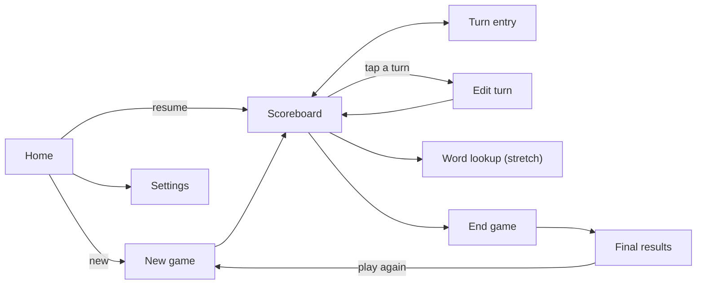
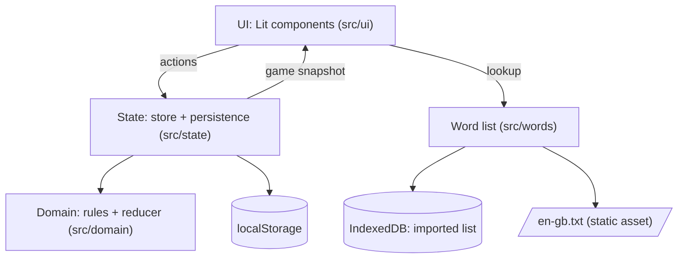

# Scrabble Scorer: Design

This application helps players keep score in a real-world game of Scrabble,
played on a physical board. Users set up a game with 2-4 players. On each turn
they enter the tiles played and the app calculates the score. It shows the
current round's scores and a running total for every player.

As a stretch goal, users can also check whether a word is legal (see
[Word lookup](#word-lookup-stretch-goal)).

## Overview and scope

### In scope

- One game at a time with 2-4 named players, in a fixed turn order.
- Scoring each turn from typed words with premium-square and blank markers.
- Running totals, a per-round breakdown and a history of turns.
- Correcting or undoing a turn.
- End-game adjustments for unplayed tiles.
- Resuming an unfinished game after the page is reloaded or closed.
- An installable **Progressive Web App (PWA)** that works offline after the
  first load (see [Progressive Web App](#progressive-web-app)).
- English-language tile set only.

### Out of scope

- Modelling the board: the app does not know where tiles are, so it cannot
  check placement or find cross-words automatically.
- Tracking each player's rack, or the tile bag beyond simple counts.
- AI opponents, move suggestions and anagram solving.
- Accounts, sync between devices and online multiplayer.

## Game rules implemented

### Tiles

| Points | Letters                      |
| ------ | ---------------------------- |
| 0      | blank (x2)                   |
| 1      | A, E, I, O, U, L, N, S, T, R |
| 2      | D, G                         |
| 3      | B, C, M, P                   |
| 4      | F, H, V, W, Y                |
| 5      | K                            |
| 8      | J, X                         |
| 10     | Q, Z                         |

Distribution (100 tiles): Ax9, Bx2, Cx2, Dx4, Ex12, Fx2, Gx3, Hx2, Ix9, Jx1,
Kx1, Lx4, Mx2, Nx6, Ox8, Px2, Qx1, Rx6, Sx4, Tx6, Ux4, Vx2, Wx2, Xx1, Yx2,
Zx1, blankx2.

These values live in a single config module so another tile set can be added
later.

### Scoring a turn

1. A turn is one or more **words**: the main word plus any cross-words formed.
2. Each letter in a word scores its face value, or **0 if it is a blank**. A
   blank keeps scoring 0 in later words that reuse it.
3. **Double and triple letter** squares multiply a letter's value. They count
   only for tiles placed this turn.
4. **Double and triple word** squares multiply the word's total after letter
   premiums. They count only for tiles placed this turn. Several stack by
   multiplying: two DW squares give x4, two TW squares give x9.
5. If a newly placed tile on a premium square is part of two words, the premium
   counts in **both** words.
6. The turn score is the sum of its words, plus a **50-point bingo bonus** if
   the player used all 7 tiles. A **bingo** means playing every tile on your
   rack in a single turn. The bonus is added once per turn, after all word
   multipliers, and is not itself multiplied.
7. The first move's centre star is a double word square. The player marks it
   like any other DW square.
8. A **pass**, an **exchange** or a word **withdrawn after a challenge** scores
   0 but still counts as the player's turn.

The app does not know which tiles are new. The player shows this by marking
premiums only on the squares covered this turn.

### End of game

The game ends when a player uses their last tile and the bag is empty, or when
the players end it by hand (for example after six scoreless turns in a row).

- Each player with tiles left enters them. The value of those tiles is
  **subtracted** from their score.
- If a player went out, the total of everyone else's unplayed tiles is
  **added** to that player's score.
- If nobody went out, every player loses the value of their own tiles and
  nobody gains.
- The winner is the highest final score. Ties are shown as ties.

## Turn input UX

Turn entry is built for speed at the table, ideally on a phone.

1. The screen shows the **current player** and the round number.
2. The player **types the main word**, A-Z only. Typing changes it to upper
   case and shows one tile per letter.
3. **Tapping a tile** cycles it through: normal -> DL -> TL -> normal. A separate
   **long-press or "blank" toggle** marks the tile as a blank. Each state looks
   distinct, colour-coded to match the board.
4. **Word multiplier** buttons toggle DW and TW, with a count (for example
   DW x2) for words that span two premium squares.
5. **"Add word"** adds another word row for each cross-word. Each row shows its
   own subtotal.
6. A **bingo toggle** adds the 50-point bonus. The player sets it by hand
   because the app can't work out how many tiles were placed. Typed words
   include tiles already on the board (extending `PLAY` to `PLAYING` is 7
   letters but only 3 new tiles), and cross-words reuse the new tiles. Asking
   players to mark every existing tile would allow automatic detection, but
   would add taps to most turns to save one tap on the rare bingo.
7. A **live preview** shows each word's score and the turn total as the player
   edits.
8. **Confirm** saves the turn and moves to the next player. **Pass / exchange**
   records a 0-point turn in one tap.
9. **Undo last turn** and **edit any previous turn** recalculate all totals.
   Scores are always worked out from the stored turns, never stored as totals.

When the word lookup is available, each word row shows a small indicator
(valid, unknown or not yet checked). It is **advisory only** and never blocks
saving a turn, because players may follow house rules.

## Screens and flows



- **Home**: start a new game, or resume the game in progress if there is one.
  Starting a new game while one is in progress asks for confirmation first.
- **New game**: enter 2-4 player names, reorder them to set the turn order,
  then start.
- **Scoreboard**: the main screen. It shows a table of rounds (rows) by players
  (columns), each player's running total, and who plays next. Tapping a cell
  opens that turn to edit.
- **Turn entry**: as described in [Turn input UX](#turn-input-ux).
- **Word lookup** (stretch): a free-text check for one word, reachable at any
  time.
- **End game**: enter each player's unplayed tiles, choose who went out (if
  anyone), then see the adjustments.
- **Final results**: final scores, the winner, and the highest-scoring turn and
  word. From here players can start a new game.
- **Settings**: keep the screen awake during games (on by default). For the
  stretch goal it also offers choosing the word list (built-in or imported),
  importing or removing a list, and downloading it for offline use.

## Architecture

The app has three layers, each depending only on the one below it:

1. **Domain** (`src/domain/`): pure TypeScript with no DOM or storage access.
   It covers tile values, turn scoring, end-game adjustments and the game
   reducer. All the rules live here, and nearly all the tests target it.
2. **State and services** (`src/state/`, `src/words/`): a small store that
   holds the current `Game`, applies actions through the domain reducer, saves
   to `localStorage` and notifies subscribers. The word list loader also lives
   here.
3. **UI** (`src/ui/`): web components built with [Lit](https://lit.dev).



### UI components

- Components extend `LitElement`, use Lit's `html` templates for rendering and
  declare reactive properties for their inputs. Each component keeps its
  template, behaviour and styles in one file.
- **Shadow DOM** (Lit's default) scopes each component's styles. Open Props
  tokens are CSS custom properties, so they pass through shadow boundaries.
  Shared base styles (reset, typography, focus ring) live in one Lit `css`
  module that every component includes.
- Data flows down through properties. User actions go up as `CustomEvent`s
  with `bubbles: true, composed: true` so they cross shadow boundaries.
- **Only pages talk to the store**, through a small Lit reactive controller
  (`StoreController`) that subscribes to the store and triggers a re-render.
  Atoms, molecules and organisms stay presentational and easy to test in
  isolation.
- Inputs are native elements inside components. Components report their values
  through events rather than as form-associated custom elements, so the app
  doesn't need `ElementInternals`.
- Decorators use **TypeScript's legacy (experimental) syntax**
  (`@property() name = ''`), with `experimentalDecorators: true` and
  `useDefineForClassFields: false`, which Lit requires for legacy decorators.
  The plan was standard TC39 decorators (`@property() accessor name`). During
  the scaffold, Rolldown/Oxc left those untranspiled, and no browser supports
  them natively, so they would fail at runtime. Legacy decorators compile
  correctly. Revisit once Oxc can lower standard decorators.

Atomic Design layout, with representative components:

| Level     | Examples                                                                                                                                              |
| --------- | ----------------------------------------------------------------------------------------------------------------------------------------------------- |
| Atoms     | `ss-tile`, `ss-button`, `ss-toggle`, `ss-badge`, `ss-text-input`                                                                                      |
| Molecules | `ss-word-row` (tiles + multipliers + subtotal), `ss-player-field`, `ss-score-cell`                                                                    |
| Organisms | `ss-turn-form`, `ss-scoreboard`, `ss-player-list`, `ss-endgame-form`, `ss-word-check`                                                                 |
| Templates | `ss-app-shell` (header, main, footer actions)                                                                                                         |
| Pages     | `ss-page-home`, `ss-page-new-game`, `ss-page-scoreboard`, `ss-page-turn`, `ss-page-end-game`, `ss-page-results`, `ss-page-lookup`, `ss-page-settings` |

### Routing

A small **hash router** (`#/scoreboard`, `#/turn/12`) maps routes to page
elements. Hash routes need no server-side fallback, which suits GitHub Pages.

### Source layout

```
src/
  domain/      tiles.ts, scoring.ts, endgame.ts, validation.ts,
               game.ts (create, reducer, selectors), types.ts,
               testing.ts (test helpers)
  state/       store.ts, storage.ts, migrations.ts, schema.ts (validation
               on load), testing.ts (test fixtures)
  words/       lexicon.ts (load + lookup), import.ts (user list, IndexedDB)
  ui/
    atoms/ molecules/ organisms/ templates/ pages/
    styles/    base.ts (shared Lit css for every shadow root)
  styles/      global.css (Open Props imports, tokens, base styles)
  router.ts
  main.ts
scripts/
  build-wordlist.ts
```

## Data model and persistence

### Types

```ts
type Premium = 'none' | 'DL' | 'TL';

interface TilePlay {
  letter: string; // 'A'-'Z'
  blank: boolean; // scores 0
  premium: Premium; // only set on tiles placed this turn
}

interface WordPlay {
  tiles: TilePlay[];
  doubleWords: number; // DW squares covered this turn
  tripleWords: number; // TW squares covered this turn (at most 3 word squares in total)
}

// A turn as entered; the reducer adds id, playerId and at.
type TurnInput =
  | { kind: 'play'; words: WordPlay[]; bingo: boolean }
  | { kind: 'pass' | 'exchange' | 'withdrawn' };

type Turn = TurnInput & { id: string; playerId: string; at: string };

interface Player {
  id: string;
  name: string;
}

interface EndGame {
  wentOutPlayerId: string | null;
  remaining: Record<string, string>; // playerId -> letters left, '?' for a blank
}

interface Game {
  schemaVersion: 1;
  id: string;
  createdAt: string;
  updatedAt: string;
  players: Player[]; // in turn order
  turns: Turn[]; // in play order
  status: 'active' | 'finished';
  endGame?: EndGame;
}
```

- **Only inputs are stored.** Word scores, turn scores, totals and round
  numbers are worked out by domain functions, so editing an old turn can never
  leave stale totals.
- The **round** is `Math.floor(turnIndex / players.length) + 1`. The **next
  player** is `players[turns.length % players.length]`.
- **Undo** removes the last turn. **Edit** replaces a turn's content but keeps
  its `id`, `playerId` and position.
- A game is created with `createGame({ id, at, players })`. After that, state
  changes go through a reducer, `reduce(game, action) => game`, with the
  actions `addTurn`, `editTurn`, `undoTurn`, `finishGame` and `reopenGame`.
  (The plan had a `startGame` action. A separate function avoids a reducer
  over `Game | null`.)
- **No `switch` on action type or turn kind.** Each is handled by a strategy
  map typed per variant, so every handler gets its own narrowed type with no
  casts:
  - `ACTION_HANDLERS: { [T in GameActionType]: (game, action: GameActionOf<T>) => Game }`,
    with `reduce` looking up `ACTION_HANDLERS[action.type]`.
  - `TurnStrategies<R>` and `byTurnKind(strategies, turn)` for anything that
    varies by turn kind, such as scoring (`TURN_SCORERS`) and validation
    (`TURN_VALIDATORS`).

  Adding a new action or turn kind is then a type error until every map
  handles it.

- **Ids and timestamps are passed in** with each action, never generated in
  the domain, so the reducer is pure and deterministic. The store supplies
  them.
- The reducer returns a new game and never mutates the old one. Invalid input
  throws a `GameError` with a message fit to show the player.
- **Validation:**
  - Players: 2-4, each with a name (trimmed), no duplicate names in any case.
  - Words: 2-15 letters A-Z.
  - A turn: at most 8 words, the main word plus one cross-word per tile.
  - Word squares: at most 3 per word, such as a row of 15 across three TWs.
  - A bingo needs a word of at least 7 letters.
  - End game: up to 7 tiles left per player (A-Z, `?` for a blank), and the
    player who went out has none left.
  - Nothing can change in a finished game until it is reopened.
- Selectors derive everything else: `nextPlayer`, `currentRound`,
  `scoredTurns`, `scoreboardRounds`, `playerTotals` (including end-game
  adjustments), `standings` (ranking and tied leaders), `bestTurn` and
  `bestWord`.

### Persistence

The state layer (`src/state/`) sits between the domain and the UI.

- **Storage keys:**
  - `scrabble-scorer:current` holds the game in progress, or the one just
    finished.
  - `scrabble-scorer:history` holds up to 20 finished games, newest first,
    with the oldest dropped. Adding a game that is already there replaces it
    rather than duplicating it.
- **Choosing storage (`chooseStorage`):** the app uses `localStorage` only if
  a test write succeeds. If storage is blocked (for example in some private
  windows) it falls back to in-memory storage and reports
  `persistent: false`, so the UI can warn that games won't survive a reload.
  The app talks to storage through a small `KeyValueStorage` interface
  (`getItem`, `setItem`, `removeItem`), so tests use in-memory storage.
- **Migrations (`migrations.ts`):** every stored game has a `schemaVersion`.
  - `MIGRATIONS` maps the version a step upgrades from to a function that
    returns the next version. `migrate()` runs each step in turn up to
    `CURRENT_SCHEMA_VERSION` (currently 1, so the map is empty).
  - Data from a newer app version, with no version, or with a gap in the
    steps is rejected.
  - A migrated game is saved straight back, so it only migrates once. If that
    save fails, the game still loads.
- **Validation on load (`schema.ts`):** `parseGame()` checks the shape of
  every field, using lookup tables of field checks and of per-turn-kind
  checks. It then re-applies the domain rules:
  - player and turn validation
  - turns are in turn order
  - the end game is present exactly when the game is finished
- **Unreadable data:**
  - Bad JSON, the wrong shape, broken rules or a newer version are never
    thrown away and never crash the app. The raw text is copied to
    `scrabble-scorer:corrupt-<timestamp>`, the original key is cleared, and
    the player sees a notice.
  - In the history, unreadable entries are skipped, with a notice saying how
    many.
  - If storage can't even be read, the app starts empty with a notice.
- **Saving:** the store saves after every successful action, and saves the
  history only when it changed. A game is a few KB, well inside the
  `localStorage` limit. If a save fails (storage full or turned off), the
  change is kept in memory and the player sees a notice.
- **Multiple tabs:** if the game is open in several tabs, the last write
  wins. Syncing between tabs is out of scope.
- The word list is **not** stored in `localStorage` (see below).

### Store

`new GameStore({ storage, now?, newId?, migrateOptions? })` is a class: a
long-lived object with private state (`#state`, `#listeners`) set up in the
constructor. Its public methods are arrow-function fields, so they stay bound
when passed as callbacks (`@click=${store.undoTurn}`). Private helpers
(`#commit`, `#apply`) are ordinary private methods.

- **Loading:** it loads the current game and the history when created.
- **Clock and ids:** `now` and `newId` default to `new Date().toISOString()`
  and `crypto.randomUUID()`. Tests pass predictable ones instead.
- **State:** `{ game, history, notice }`. `getState()` returns a new object
  after every change, so changes can be detected by identity.
  `subscribe(listener)` returns an unsubscribe function.
- **Actions:**
  - `startGame(names)`, `addTurn(turn)`, `editTurn(turnId, turn)`,
    `undoTurn()`, `finishGame(endGame)`, `reopenGame()`. Each supplies the id
    and time and applies the domain reducer.
  - Each returns an `Outcome`, either `{ ok: true }` or
    `{ ok: false, error }`. A broken rule (`GameError`) becomes an error
    message for the UI, and nothing changes or is saved. Any other error is a
    bug and is rethrown.
  - `startGame` moves a finished current game into history. It discards an
    active one; the UI asks the player to confirm first.
  - `discardGame()` drops the current game without adding it to history.
  - `dismissNotice()` clears the notice.
- **Later milestones:**
  - Wiring the store to the browser (`chooseStorage(() => localStorage)`) and
    the Lit `StoreController` belong to `scrabble-0005`.
  - `navigator.storage.persist()` belongs to `scrabble-0008`.

## Word lookup (stretch goal)

### Findings

- **No free API can give an authoritative Scrabble answer.** General
  dictionary APIs such as dictionaryapi.dev and Merriam-Webster are not
  Scrabble word lists. Their availability isn't guaranteed, and keyed APIs
  would expose the key in a client-side app.
- **The official lists are copyrighted.** Collins Scrabble Words (used in the
  UK, about 280k words) belongs to HarperCollins. The NASPA Word List (North
  America) is licensed through NASPA. Neither can be redistributed in this app.
- **Freely redistributable alternatives:**
  - **ENABLE**: public domain, about 173k words, built for word games.
  - **SCOWL / VarCon**: a permissive licence (keep the copyright notice), with
    British spelling variants.
- **Cloudflare is not needed.** A server-side lookup on the free Workers tier
  would work, but it adds nothing over a static file. It doesn't solve
  licensing, and it makes offline use harder.

### Approach: a built-in British English list

A one-off build script, `scripts/build-wordlist.ts`, creates the bundled list:

1. Take ENABLE, normalise it to lowercase and keep only `^[a-z]{2,15}$`.
2. Add British spelling variants from VarCon whose American form is in ENABLE,
   such as `-ise`/`-isation`, `-our`, doubled `-ll-`, `-tre` and `ae`/`oe`.
   Using these explicit pairs avoids picking up SCOWL's proper nouns,
   abbreviations and modern slang.
3. Optionally merge a small hand-curated `extras.txt` for well-known gaps
   (ENABLE predates words such as QI and ZA).
4. Write `src/words/en-gb.txt` (one word per line, sorted) and
   `THIRD_PARTY_NOTICES.md` with the ENABLE and SCOWL attributions. Both are
   committed, so a normal build never downloads anything.

A prototype run measured these figures:

| Measure                             | Value                                                 |
| ----------------------------------- | ----------------------------------------------------- |
| ENABLE after filtering              | 168,551 words                                         |
| British variants added (heuristic)  | ~500 (e.g. _recognise_, _kilometres_, _orthopaedist_) |
| Final list                          | ~169k words, ~1.7 MB raw                              |
| Gzipped (as served by GitHub Pages) | ~0.44 MB                                              |

ENABLE already contains many British spellings (_colour_, _realise_,
_theatre_), so the gap is mostly derived forms.

**Known limitation:** this fixes spelling, not vocabulary. Collins includes
about 100k more words, many of them Scots, Commonwealth or obscure, so some
words valid in Collins will be reported as "not found". The UI wording should
reflect this: "not in word list", not "invalid".

### Optional: import your own list

On a settings screen, a user can import a plain-text word list they own, such
as Collins or NWL, one word per line. It is normalised with the same filter
and stored in **IndexedDB** on that device only. It is never uploaded,
committed or hosted. The user can choose between the built-in list and the
imported one, and remove the imported list at any time.

### Loading and lookup

- The list is imported with Vite's `?url` suffix, so it gets a content-hashed
  file name and is cached long-term.
- It is fetched **lazily** the first time a lookup is needed, so it doesn't
  slow down the first load. The UI shows "loading word list..." until it is
  ready.
- It is parsed into a `Set<string>` for O(1) lookups. If memory turns out to
  be a problem on low-end phones, a sorted array with binary search is the
  fallback.
- The service worker (see [Deployment](#deployment)) caches it for offline use.

## Tech stack and tooling

Keep it as simple as possible: HTML, CSS and TypeScript, with no UI framework.

- **Toolchain:** [Vite+](https://github.com/voidzero-dev/vite-plus) 1.8 via
  its `vp` CLI, installed as a project dev dependency (no global install
  needed). It covers the dev server and build (Vite 8 / Rolldown), tests
  (Vitest 5), linting (Oxlint), formatting (Oxfmt) and type checking (tsrs).
  All of it is configured in `vite.config.ts`. npm `overrides` pin `vite` and
  `vitest` to the copies Vite+ bundles, as its docs require; update them
  whenever Vite+ is upgraded (`npx vp toolchain` shows the versions).
- **Type checking:** done by `vp check` (lint `typeAware` + `typeCheck`), so
  `tsc` and the `typescript` package aren't needed.
- **Running scripts:** TypeScript scripts run with `vpx <file>` (for example
  `vpx scripts/build-wordlist.ts`), with no `tsx` or `ts-node`.
- **Language:** TypeScript with `strict` on; the domain layer uses no `any`.
- **Package manager:** npm, with Node 26 pinned in `.nvmrc`.
- **Styling:** [Open Props](https://open-props.style) for design tokens
  (sizes, colours, fonts, shadows) and its normalise stylesheet. Plain CSS
  using nesting and custom properties, with no preprocessor. Light and dark
  themes use `prefers-color-scheme`. Premium colours match the board: DL light
  blue, TL dark blue, DW pink, TW red.
- **UI library:** Lit 3.
- **Runtime dependencies:** `lit`, `open-props`, plus `idb-keyval` (under
  1 KB) for the imported word list. Nothing else.
- **Diagrams:** Mermaid code blocks in Markdown.
- **npm scripts:** `dev`, `build`, `preview`, `check` (format check, lint and
  types), `fix`, `lint`, `format`, `test` (single run), `test:watch`,
  `test:coverage`, and later `build:wordlist`.
- **Dev dependencies:** `vite-plus` and `@vitest/coverage-v8`, pinned to
  the Vitest version Vite+ bundles.

## Development workflow

- **Branches:** one branch per unit of work, named `scrabble-NNNN` with the
  number going up by one each time (`scrabble-0001` is design and planning).
  Each branch is merged into `main` through a pull request before the next one
  starts.
- **Commits:** Conventional Commits (`feat:`, `fix:`, `docs:`, `chore:`,
  `test:`, ...), one line in the imperative mood.
- `main` is never committed to directly.

## Code style

- Arrow functions (`const fn = (...) => ...`) rather than `function`
  declarations for stateless logic.
- Classes for stateful objects with a lifecycle: the store (`GameStore`),
  and later controllers and Lit components. Private state goes in `#fields`.
  Public methods that may be passed as callbacks are arrow-function fields,
  so they stay bound.
- Lookup maps and strategy functions rather than `switch` statements or
  `if`/`else if` chains. Single guard clauses (early return or throw) are
  fine. Maps over a union are typed per variant (see
  [Types](#types)) so handlers need no casts.

## Testing

All tests run on Vitest through Vite+ (`vp test`).

**Conventions:**

- Every non-trivial function has tests, including validation and test
  helpers. Each source file has a matching `*.test.ts`.
- Cover the happy path and, especially, the edge cases that break things:
  boundaries (2 and 15 letters, 2 and 4 players, 7 and 8 tiles), empty input,
  invalid characters, duplicates, and impossible states.
- One behaviour per test with a descriptive name, grouped in `describe`
  blocks (for example `accepts` / `rejects`). Tables (`it.each`) only for
  simple input -> output data.
- Tests use `// Arrange`, `// Act` and `// Assert` comments, each its own
  statement(s): inputs are built as named variables in Arrange; Act is a
  single call assigned to a variable (`const act = () => fn(input)` for
  throws); Assert only holds `expect`s. Sections are never merged.
- Prose and comments use ASCII. Test inputs that need a specific non-ASCII
  character, such as `'É'` for rejecting accented letters, use it directly.

- **Domain and state unit tests (Node)**, the priority. Coverage of
  `src/domain` and `src/state` is held at **100%** (statements, branches, functions, lines) by a threshold in
  `vite.config.ts`, so CI fails if it drops. Tests use a compact word helper
  (`src/domain/testing.ts`): `word('Z3AP', { dw: 1 })` is Z on a TL, then A and
  P, on a DW square; lower case means a blank. Table-driven cases cover:
  - letter values, blanks, and DL/TL on blanks (still 0)
  - DW/TW applied after letter premiums, and stacking (x4, x9, DW+TW = x6)
  - several words in one turn, including a premium shared by two words
  - bingo bonus
  - pass, exchange and withdrawn turns
  - end-game adjustments, with and without a player going out, and ties
  - the reducer: add, edit and undo turns; round and next-player calculation
  - known real-game turns as regression fixtures
- **Persistence tests:**
  - saving and loading round-trips
  - migrations (single and multiple steps, gaps, newer versions)
  - every kind of unreadable data, including setting it aside and the
    notices shown
  - blocked or full storage, including a failure partway through
  - the store's actions, outcomes, saving and listeners

  Fixtures are in `src/state/testing.ts`, e.g. `failingStorage(['setItem'])`
  and `sequentialClock()`.

- **Word list tests:** the built list is sorted, lowercase, `[a-z]{2,15}`
  and free of duplicates. It contains sample British spellings (_colour_,
  _recognise_) and excludes sample proper nouns. Lookups are case-insensitive.
- **Component tests:** Vitest browser mode with Playwright (Chromium) for
  organisms with real behaviour, such as `ss-turn-form` (tap cycling, live
  totals) and `ss-scoreboard`.
- **End-to-end smoke test:** one Playwright flow (new game -> three turns ->
  undo -> end game -> results) run against `vp preview`.
- **CI:** `.github/workflows/ci.yml` runs on every pull request and every push
  to `main`: `npm ci`, `npm run check` (format, lint, types), `npm run test:coverage`, then
  `npm run build`. It's a required status check on `main`.

## Deployment

The app is wholly client-side, with no server; all game data is stored in the
browser. It is a static site hosted on **GitHub Pages**. Cloudflare Pages
remains an option if ever needed, but neither the word lookup nor anything
else requires it.

- **Workflow:** a GitHub Actions workflow runs on every push to `main`. It
  runs `npm ci`, then the same checks as PR CI, then the build. It uploads
  `dist/` with `actions/upload-pages-artifact` and publishes it with
  `actions/deploy-pages`. Pages is set to use "GitHub Actions" as its source.
- **Base path:** the site is served from `/<repo-name>/`, so Vite's `base` is
  set to match. Asset URLs, including the word list, use
  `import.meta.env.BASE_URL` or Vite's `?url` imports, never absolute paths.
  Hash routing means deep links need no `404.html` fallback.
- **HTTPS:** GitHub Pages serves over HTTPS, which service workers and PWA
  installation require.
- **Cost:** GitHub Pages and Actions are free for public repositories.

## Progressive Web App

The app is a PWA so players can install it on a phone's home screen and use
it at the table without a connection. It fits well: there's no server, the
data is already local, and the only large asset (the word list) is a static
file.

### Installability

- **Manifest** (`manifest.webmanifest`): `name`, `short_name`,
  `display: standalone`, `orientation: portrait`, `theme_color` and
  `background_color` taken from the Open Props palette, and icons at 192 px
  and 512 px plus a maskable 512 px icon. `start_url` and `scope` are set to
  the Pages base path (`/<repo-name>/`), not `/`.
- **Android and desktop Chromium:** the browser offers its own install prompt.
  The app catches `beforeinstallprompt` and shows an "Install app" button on
  the home screen rather than relying on the browser's banner.
- **iOS / iPadOS Safari:** there is no install prompt. The home screen shows a
  one-off hint ("Share -> Add to Home Screen") when the app is running in
  Safari and not yet installed (`navigator.standalone === false`). The
  `apple-touch-icon` and `apple-mobile-web-app-*` meta tags are included.

### Service worker and caching

- **Precache** the app shell (HTML, JS, CSS, icons, manifest) when the app is
  installed, so everything except the word list works offline straight away.
- **Word list:** cache-first at runtime. It is cached the first time a lookup
  happens. The settings screen offers "Download word list for offline use" so
  players can fetch it before going offline.
- **Updates:** a new service worker waits rather than taking over straight
  away. The app shows "New version available - reload" and only activates it
  when the player taps, so a game is never reloaded mid-turn.
- **Tooling:** `vite-plugin-pwa` 2 (Workbox) generates the manifest and
  service worker. A throwaway test during `scrabble-0002` confirmed it works
  with Vite+ 1.8. It builds `manifest.webmanifest` and `sw.js` with `start_url`
  and `scope` set from the `/scrabble-scorer/` base. In Chrome, the service
  worker registered and precached the app shell under that scope. The
  hand-written fallback is no longer expected to be needed. One note: its
  `workbox-build` dependency brings in `glob` and `minimatch` versions with
  moderate `npm audit` advisories. These are build-time only and not shipped
  to users.

### Data durability

- The app calls `navigator.storage.persist()` when the first game starts. This
  asks the browser not to clear the app's storage (`localStorage` and the
  IndexedDB word list) when the device is low on space.
- Safari may delete script-written storage for sites that haven't been used
  for 7 days, but not for installed home-screen apps. The iOS install hint
  mentions this ("install to keep your games safe").
- Losing data costs little (an unfinished game), but this is why export and
  import of game history is listed under [Future ideas](#future-ideas).

### At the table

- **Screen Wake Lock:** while a game is in progress, the app requests a
  screen wake lock (`navigator.wakeLock.request('screen')`) so the phone
  doesn't sleep between turns. It requests the lock again when the app comes
  back into view, and skips this quietly where the API isn't supported.
  Players can turn this off in settings.
- Layout is portrait-first with large touch targets, at least 44 px, and
  respects safe-area insets (`env(safe-area-inset-*)`) in standalone mode.

## Implementation plan

Each milestone is one `scrabble-NNNN` branch and pull request (see
[Development workflow](#development-workflow)).

| Branch          | Milestone                                                                                        |
| --------------- | ------------------------------------------------------------------------------------------------ |
| `scrabble-0001` | Design document (this file)                                                                      |
| `scrabble-0002` | Project scaffold: Vite+, TypeScript, Lit, Open Props, lint/format/test config, PR CI             |
| `scrabble-0003` | Domain: tiles, turn scoring, end game, reducer, with full unit tests                             |
| `scrabble-0004` | State: store, persistence, migrations                                                            |
| `scrabble-0005` | UI foundations: app shell, router, atoms, base styles; new-game and scoreboard pages             |
| `scrabble-0006` | Turn entry: word rows, premium toggles, live preview, edit and undo                              |
| `scrabble-0007` | End game and results; game history                                                               |
| `scrabble-0008` | Deployment and PWA: Pages workflow, base path, manifest, service worker, install hint, wake lock |
| `scrabble-0009` | Stretch: word list build script, lookup page, inline word check                                  |
| `scrabble-0010` | Stretch: settings and importing your own word list                                               |

The core game is usable after `scrabble-0007` and published after
`scrabble-0008`.

## Future ideas

- Other languages' tile sets (the tile config is already separate).
- A licensed Collins list, if a free or affordable licence for
  non-commercial use turns out to exist.
- Statistics across games: averages, best words, head-to-head records.
- A turn timer or chess-style clock.
- Recording challenges (who challenged and the result).
- Sharing a final scoreboard as an image or link.
- Exporting and importing game history as a JSON file (backup, or moving to
  another device).
- Recognising the board from a photo to enter turns automatically.
