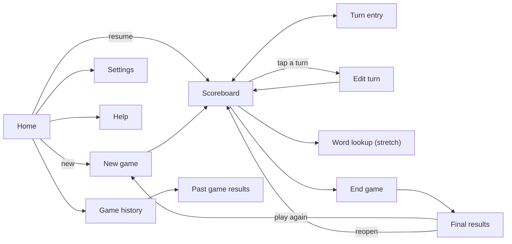
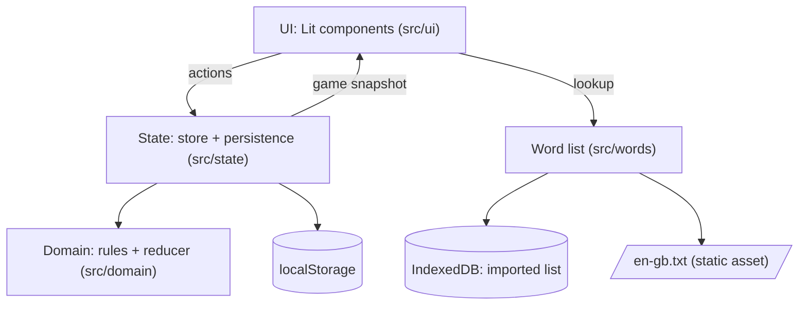

# Scrabble Scorer: Design

This application helps players keep score in a real-world game of Scrabble,
played on a physical board. Users set up a game with 2-4 players. On each turn
they enter the tiles played and the app calculates the score. It shows the
current round's scores and a running total for every player.

As a stretch goal, users can also check whether a word is legal (see
[Word lookup](#word-lookup-stretch-goal)).

## Overview and scope

### In scope

- One game at a time with 2-4 named players, in a fixed turn order.
- Scoring each turn from typed words with premium-square and blank markers.
- Running totals, a per-round breakdown and a history of turns.
- Correcting or undoing a turn.
- End-game adjustments for unplayed tiles.
- Resuming an unfinished game after the page is reloaded or closed.
- An installable **Progressive Web App (PWA)** that works offline after the
  first load (see [Progressive Web App](#progressive-web-app)).
- English-language tile set only.

### Out of scope

- Modelling the board: the app does not know where tiles are, so it cannot
  check placement or find cross-words automatically.
- Tracking each player's rack, or the tile bag beyond simple counts.
- AI opponents, move suggestions and anagram solving.
- Accounts, sync between devices and online multiplayer.

## Game rules implemented

### Tiles

| Points | Letters                      |
| ------ | ---------------------------- |
| 0      | blank (x2)                   |
| 1      | A, E, I, O, U, L, N, S, T, R |
| 2      | D, G                         |
| 3      | B, C, M, P                   |
| 4      | F, H, V, W, Y                |
| 5      | K                            |
| 8      | J, X                         |
| 10     | Q, Z                         |

Distribution (100 tiles): Ax9, Bx2, Cx2, Dx4, Ex12, Fx2, Gx3, Hx2, Ix9, Jx1,
Kx1, Lx4, Mx2, Nx6, Ox8, Px2, Qx1, Rx6, Sx4, Tx6, Ux4, Vx2, Wx2, Xx1, Yx2,
Zx1, blankx2.

These values live in a single config module so another tile set can be added
later.

### Scoring a turn

1. A turn is one or more **words**: the main word plus any cross-words formed.
2. Each letter in a word scores its face value, or **0 if it is a blank**. A
   blank keeps scoring 0 in later words that reuse it.
3. **Double and triple letter** squares multiply a letter's value. They count
   only for tiles placed this turn.
4. **Double and triple word** squares multiply the word's total after letter
   premiums. They count only for tiles placed this turn. Several stack by
   multiplying: two DW squares give x4, two TW squares give x9.
5. If a newly placed tile on a premium square is part of two words, the premium
   counts in **both** words.
6. The turn score is the sum of its words, plus a **50-point bingo bonus** if
   the player used all 7 tiles. A **bingo** means playing every tile on your
   rack in a single turn. The bonus is added once per turn, after all word
   multipliers, and is not itself multiplied.
7. The first move's centre star is a double word square. The player marks it
   like any other DW square.
8. A **pass**, an **exchange** or a word **withdrawn after a challenge** scores
   0 but still counts as the player's turn.

The app does not know which tiles are new. The player shows this by marking
premiums only on the squares covered this turn.

### End of game

The game ends when a player uses their last tile and the bag is empty, or when
the players end it by hand (for example after six scoreless turns in a row).

- Each player with tiles left enters them. The value of those tiles is
  **subtracted** from their score.
- If a player went out, the total of everyone else's unplayed tiles is
  **added** to that player's score.
- If nobody went out, every player loses the value of their own tiles and
  nobody gains.
- The winner is the highest final score. Ties are shown as ties.

## Turn input UX

Turn entry is built for speed at the table, ideally on a phone. It's the
`#/turn` page, reached from **"Enter turn (Ann)"** on the scoreboard.

1. The heading names the **current player** ("Ann's turn") and the round.
2. **Turn type** radios: Played a word / Passed / Exchanged tiles / Word
   withdrawn after a challenge. Anything except a play saves as a 0-point
   turn, and the word fields are hidden (but kept, in case of a mis-tap).
3. The player **types the main word** into a letters field. Anything that
   isn't A-Z is dropped, letters are shown in capitals, and the limit is 15.
   One tile appears per letter.
4. **Tapping a tile** cycles it through **normal -> DL -> TL -> blank ->
   normal**.
   - A blank always scores 0, so its letter premium never matters. That makes
     "blank" a single extra step rather than a separate long-press, which
     keyboard and screen reader users couldn't reach.
   - The mark is shown as text ("DL", "TL", "Blank") as well as colour.
   - The tile's name says it, e.g. "Q, 10 points, triple letter", and each
     tap is announced ("Q: triple letter.").
   - Tiles stay cream with dark letters in both light and dark mode, like the
     physical tiles.
5. **Editing the letters keeps marks** on positions whose letter didn't
   change (`retile`), so fixing a typo doesn't clear earlier premiums.
6. **Word squares** are two radio groups per word: "Double word squares" and
   "Triple word squares", each None / 1 / 2 / 3. Counts that would take the
   word over 3 word squares in total are disabled.
7. **"Add cross-word"** adds another word row, up to 8 words in total.
   Cross-words can be removed; the main word can't. Each row shows its own
   score.
8. A **Bingo** checkbox adds the 50-point bonus, and a bingo needs a word of
   at least 7 letters. The player sets it by hand because the app can't work
   out how many tiles were placed:
   - Typed words include tiles already on the board: extending `PLAY` to
     `PLAYING` is 7 letters but only 3 new tiles.
   - Cross-words reuse the new tiles.

   Asking players to mark every existing tile would allow automatic
   detection, but would add taps to most turns to save one tap on the rare
   bingo.

9. The **turn total** updates as the player edits. It isn't announced on every
   keystroke.
10. **Save turn** checks each word (entered, at least 2 letters) and the bingo
    rule, moving focus to the first problem. It then records the turn and
    returns to the scoreboard. Enter in a letters field saves too. **Cancel**
    goes back without saving.
11. **Pass** is also a one-tap button on the scoreboard. **Undo last turn**
    asks for confirmation.
12. **Editing:** each score on the scoreboard links to editing that turn
    (`#/turn/<id>`), labelled e.g. "5: edit Ann's round 1 turn". The form
    opens with the turn as it was. Totals are recalculated, because scores are
    always worked out from the stored turns. A finished game's scores aren't
    links.

When the word lookup is available, each word row shows a small indicator
(valid, unknown or not yet checked). It is **advisory only** and never blocks
saving a turn, because players may follow house rules.

## Screens and flows



- **Header, on every page:** the app name links home, and a "Main"
  navigation has **Help** and **Settings**. The current page's link is marked
  with `aria-current="page"`.
- **Home**:
  - Start a new game, or resume the game in progress if there is one.
    Starting a new game while one is in progress asks for confirmation first.
  - **Install app**, shown only when the browser can install (see
    [Installability](#installability)).
  - **How it works**: three steps (start a game, enter each turn, end the
    game) and a link to the full help.
- **Help** (`#/help`): a `<details>` accordion of topics in the order a game
  goes:
  - what the app does, starting a game, entering a turn
  - marking premium squares and blanks
  - cross-words and bingos; passing, exchanging and challenges
  - fixing mistakes; ending the game
  - where games are saved; offline use and installing

  Several topics can be open at once, and there are no headings inside the
  `<summary>` elements, which some screen readers drop.

- **New game**: enter 2-4 player names, reorder them to set the turn order,
  then start.
- **Scoreboard**: the main screen. It shows a table of rounds (rows) by players
  (columns), each player's running total, and who plays next. Tapping a cell
  opens that turn to edit.
- **Turn entry**: as described in [Turn input UX](#turn-input-ux).
- **Word lookup** (stretch): a free-text check for one word, reachable at any
  time.
- **End game** (`#/end`, reached from "End game" on the scoreboard):
  - **Tiles left:** one field per player, typed as letters with `?` for a
    blank (up to 7), showing each rack's value as you type.
  - **Who went out?** radios: Nobody or a player. When exactly one rack is
    left empty, that player is picked automatically, until the player picks
    one by hand.
  - **Checks:** a rack must hold at most 7 tiles, and the player who went out
    must have an empty rack.
  - **Preview:** a table of turn points, adjustment and total for each
    player. **Finish game** then shows the results.
- **Final results** (`#/results`):
  - The outcome ("Ann wins with 55 points." or "Ann and Bob tie on 280
    points.").
  - The final ranking with turn points, end-game adjustment and total; the
    winner or winners are in bold.
  - The best turn and best word.
  - Actions: **New game** (the same players are filled in, and starting moves
    this game into history), **See the scoreboard**, and **Reopen game**,
    which asks first, removes the adjustments and goes back to the
    scoreboard to fix turns.
- **Game history** (`#/history`):
  - **The list:** finished games, newest first, each with its date
    (`Intl.DateTimeFormat`, en-GB), scores and outcome, linking to
    `#/history/<id>`. An invalid timestamp shows as "an unknown date" rather
    than breaking the page.
  - **One game:** its results, with **Delete this game**.
  - **Deleting:** **Delete all saved games** is on the list. Both deletes ask
    for confirmation first.
  - **From home:** the saved-games count on the home page links here.
- **Check a word** (`#/lookup`): see [Loading and lookup](#loading-and-lookup).
- **Settings** (`#/settings`): "Keep the screen on during games" and "Check
  words as I type them" (both on by default), saved on the device, plus
  "Download the word list for offline use". Importing your own list will join
  it in `scrabble-0010`.

## Architecture

The app has three layers, each depending only on the one below it:

1. **Domain** (`src/domain/`): pure TypeScript with no DOM or storage access.
   It covers tile values, turn scoring, end-game adjustments and the game
   reducer. All the rules live here, and nearly all the tests target it.
2. **State and services** (`src/state/`, `src/words/`): a small store that
   holds the current `Game`, applies actions through the domain reducer, saves
   to `localStorage` and notifies subscribers. The word list loader also lives
   here.
3. **UI** (`src/ui/`): web components built with [Lit](https://lit.dev).



### UI components

- Components extend `LitElement`, use Lit's `html` templates for rendering and
  declare reactive properties for their inputs. Each component keeps its
  template, behaviour and styles in one file.
- **Shadow DOM** (Lit's default) scopes each component's styles. Open Props
  tokens are CSS custom properties, so they pass through shadow boundaries.
  Shared base styles (reset, typography, focus ring) live in one Lit `css`
  module that every component includes.
- Data flows down through properties. User actions go up as `CustomEvent`s
  with `bubbles: true, composed: true` so they cross shadow boundaries.
- **Only pages talk to the store.** They extend a small `PageElement` base
  class that holds the `store` property and a Lit reactive controller,
  `StoreController`. The controller subscribes while the page is connected
  and re-renders it on every change. Atoms, molecules and organisms stay
  presentational and easy to test in isolation.
- Inputs are native elements inside components. Components report their values
  through events rather than as form-associated custom elements, so the app
  doesn't need `ElementInternals`. Typed event classes (`StartGameEvent`,
  `DismissNoticeEvent`) are added to `HTMLElementEventMap`.
- **No custom element just to restyle a native one.** A `<button>` or
  `<input>` inside another component's shadow root is cut off from a
  surrounding `<form>`, so submit and label association break. Following the
  web-components guidance, buttons and fields are **native elements styled
  by shared atom styles** (`buttonStyles`, `fieldStyles`,
  `visuallyHiddenStyles`), not wrapper components. A custom element is used
  only for encapsulated behaviour. For example, the new-game form and turn
  form are each one organism that owns its `<form>` and inputs. The tile atom
  and word-row molecule are **template helpers** (render functions plus
  styles) used inside the turn form. As separate elements, their own shadow
  roots would cut their inputs and radios off from the form, breaking
  Enter-to-submit and radio grouping.
- **Accessible names of interactive elements** that need more than their
  visible text (score links, tiles) are set with `aria-label`, starting with
  the visible text so voice control users can say what they see. Hidden extra
  text inside a link or button doesn't work: the browser adds a space before
  the positioned, visually hidden text, so "5, edit" reads as "5 , edit".
- Decorators use **TypeScript's legacy (experimental) syntax**
  (`@property() name = ''`), with `experimentalDecorators: true` and
  `useDefineForClassFields: false`, which Lit requires for legacy decorators.
  The plan was standard TC39 decorators (`@property() accessor name`). During
  the scaffold, Rolldown/Oxc left those untranspiled, and no browser supports
  them natively, so they would fail at runtime. Legacy decorators compile
  correctly. Revisit once Oxc can lower standard decorators.

Atomic Design layout. Built so far in **bold**; the rest are planned:

| Level     | Examples                                                                                                                                                                           |
| --------- | ---------------------------------------------------------------------------------------------------------------------------------------------------------------------------------- |
| Atoms     | **`buttonStyles`, `fieldStyles`, `visuallyHiddenStyles`** (shared styles for native elements); **tile** (`renderTile` + `tileStyles`)                                              |
| Molecules | **`ss-confirm-dialog`**; **word row** (`renderWordRow` + `wordRowStyles`: letters, tiles, word squares, score)                                                                     |
| Organisms | **`ss-new-game-form`, `ss-scoreboard`, `ss-turn-form`, `ss-endgame-form`, `ss-results`**; `ss-word-check`                                                                          |
| Templates | **`ss-app-shell`** (header with app name, notices, main)                                                                                                                           |
| Pages     | **`ss-page-home`, `ss-page-new-game`, `ss-page-game`** (scoreboard), **`ss-page-turn`, `ss-page-end`, `ss-page-results`, `ss-page-history`**; `ss-page-lookup`, `ss-page-settings` |

Outside these levels, **`ss-app`** (`src/ui/ss-app.ts`) follows the hash,
renders the matching page inside the shell and passes it the store. It's
application wiring rather than a component, so it isn't one of the five
levels.

### Routing

- **Routes:** `src/ui/router.ts` holds `ROUTES`, a `Map` from base hash to
  page and its document title:
  - `#/` home, `#/new` new game, `#/game` scoreboard
  - `#/turn` records a turn, and `#/turn/<id>` edits one
  - `#/end` end game, `#/results` the current game's results
  - `#/history` the list, and `#/history/<id>` a past game (`historyPath`)
  - `#/help`, `#/settings`, `#/lookup` (check a word)

  It's a `Map` so lookups never match inherited keys like `toString`.

- **Matching:** the first path segment picks the page, and the rest is
  passed to it as a parameter (`route.param`, decoded). A malformed escape is
  kept as typed, so the page reports "turn not found" rather than quietly
  becoming a new turn. `turnPath(id?)` builds the hash. Unknown hashes show
  the home page. Hash routes need no server-side fallback, which suits GitHub
  Pages.
- **The root element:** `ss-app` listens for `hashchange` and renders the page
  for the current route, using a lookup map of render functions.
  - It updates `document.title` on each route change.
  - After navigating, but not on first load, it moves focus to the new page's
    `<h1 tabindex="-1">`, so screen readers announce the page.
  - It renders into the light DOM, so the page sits directly in the shell's
    slot.
- **Pages decide what to show when they don't apply**, rather than
  redirecting. For example, the scoreboard with no game says so and links to
  a new game.
- **Wiring:** `main.ts` picks storage with
  `chooseStorage(() => localStorage)` and creates the `GameStore`. It hands
  both the store and whether storage is persistent to `<ss-app>`. The shell
  warns when games can't be saved.

### Browser support

- Rely on **Baseline Widely available** features.
- Newer (**Newly available**) features are used only as progressive
  enhancement that degrades gracefully, with no polyfills. For example:
  - Dialogs open with `showModal()`, not invoker commands
    (`command`/`commandfor`).
  - Light-dismiss through `closedby` isn't used.
  - `overscroll-behavior` on dialogs is an enhancement.
- Colours use `light-dark()` with `color-scheme: light dark` on `:root` and
  `<meta name="color-scheme">`. Theme follows the system setting, with no
  toggle.

### Source layout

**Rule:** each layer (`domain`, `state`, `ui`, later `words`) is a **flat
folder of modules**, with each module's test beside it (`*.test.ts`, or
`*.browser.test.ts` for browser tests). A subfolder appears only for a real
classification with several members. Today that's only the Atomic Design
levels under `ui/components/`, which holds those five levels and nothing
else. A one- or two-file group stays flat; if a group grows (say, three or
more controllers), it earns a folder then.

```
src/
  main.ts            entry: picks storage, creates the store, mounts <ss-app>
  domain/            rules only, no DOM or storage
    tiles.ts, scoring.ts, endgame.ts, validation.ts, types.ts,
    game.ts (create, reducer, selectors),
    word-entry.ts (tile marks, retile, word-square limits),
    endgame-entry.ts (rack text, rack errors, who went out),
    testing.ts (test helpers)
  state/             store and persistence
    store.ts, storage.ts, migrations.ts, schema.ts (validation on load),
    settings.ts (device preferences), testing.ts (test fixtures)
  words/             word list
    en-gb.txt        the bundled list (generated, committed)
    word-list.ts     WordList: lazy load + lookup
    (0010) import.ts    a player's own list (IndexedDB)
  ui/                UI infrastructure, flat
    ss-app.ts        root element: routing, store, document title, focus
    router.ts        routes, route parameters, navigation
    store-controller.ts  Lit controller connecting pages to the store
    screen-wake-lock.ts  keeps the screen on (Screen Wake Lock API)
    install-prompt.ts    offers to install (Web Install API / beforeinstallprompt)
    base-styles.ts   shared Lit css for every shadow root
    global.css       Open Props imports, colour tokens, page base
    format.ts        signed numbers, dates, name lists
    testing.ts, test-setup.ts (browser test helpers)
    components/      the five Atomic Design levels, nothing else
      atoms/         button-styles.ts, field-styles.ts,
                     visually-hidden-styles.ts, tile.ts
      molecules/     ss-confirm-dialog.ts, word-row.ts
      organisms/     ss-new-game-form.ts, ss-scoreboard.ts, ss-turn-form.ts,
                     ss-endgame-form.ts, ss-results.ts
      templates/     ss-app-shell.ts
      pages/         page-element.ts (base class), ss-page-*.ts
scripts/
  build-wordlist.ts  builds src/words/en-gb.txt (npm run build:wordlist)
  wordlist.ts        its pure, tested logic
  extras.txt         words ENABLE predates (qi, za)
```

**Naming:**

- Custom elements are `ss-<name>.ts`.
- Lit style modules end in `-styles.ts`.
- Everything else is kebab-case.

`ss-app` sits outside `components/`: it renders nothing of its own and only
wires pages to the URL and the store, so it isn't an Atomic Design level.

## Data model and persistence

### Types

```ts
type Premium = 'none' | 'DL' | 'TL';

interface TilePlay {
  letter: string; // 'A'-'Z'
  blank: boolean; // scores 0
  premium: Premium; // only set on tiles placed this turn
}

interface WordPlay {
  tiles: TilePlay[];
  doubleWords: number; // DW squares covered this turn
  tripleWords: number; // TW squares covered this turn (at most 3 word squares in total)
}

// A turn as entered; the reducer adds id, playerId and at.
type TurnInput =
  | { kind: 'play'; words: WordPlay[]; bingo: boolean }
  | { kind: 'pass' | 'exchange' | 'withdrawn' };

type Turn = TurnInput & { id: string; playerId: string; at: string };

interface Player {
  id: string;
  name: string;
}

interface EndGame {
  wentOutPlayerId: string | null;
  remaining: Record<string, string>; // playerId -> letters left, '?' for a blank
}

interface Game {
  schemaVersion: 1;
  id: string;
  createdAt: string;
  updatedAt: string;
  players: Player[]; // in turn order
  turns: Turn[]; // in play order
  status: 'active' | 'finished';
  endGame?: EndGame;
}
```

- **Only inputs are stored.** Word scores, turn scores, totals and round
  numbers are worked out by domain functions, so editing an old turn can never
  leave stale totals.
- The **round** is `Math.floor(turnIndex / players.length) + 1`. The **next
  player** is `players[turns.length % players.length]`.
- **Undo** removes the last turn. **Edit** replaces a turn's content but keeps
  its `id`, `playerId` and position.
- A game is created with `createGame({ id, at, players })`. After that, state
  changes go through a reducer, `reduce(game, action) => game`, with the
  actions `addTurn`, `editTurn`, `undoTurn`, `finishGame` and `reopenGame`.
  (The plan had a `startGame` action. A separate function avoids a reducer
  over `Game | null`.)
- **No `switch` on action type or turn kind.** Each is handled by a strategy
  map typed per variant, so every handler gets its own narrowed type with no
  casts:
  - `ACTION_HANDLERS: { [T in GameActionType]: (game, action: GameActionOf<T>) => Game }`,
    with `reduce` looking up `ACTION_HANDLERS[action.type]`.
  - `TurnStrategies<R>` and `byTurnKind(strategies, turn)` for anything that
    varies by turn kind, such as scoring (`TURN_SCORERS`) and validation
    (`TURN_VALIDATORS`).

  Adding a new action or turn kind is then a type error until every map
  handles it.

- **Ids and timestamps are passed in** with each action, never generated in
  the domain, so the reducer is pure and deterministic. The store supplies
  them.
- The reducer returns a new game and never mutates the old one. Invalid input
  throws a `GameError` with a message fit to show the player.
- **Validation:**
  - Players: 2-4, each with a name (trimmed), no duplicate names in any case.
  - Words: 2-15 letters A-Z.
  - A turn: at most 8 words, the main word plus one cross-word per tile.
  - Word squares: at most 3 per word, such as a row of 15 across three TWs.
  - A bingo needs a word of at least 7 letters.
  - End game: up to 7 tiles left per player (A-Z, `?` for a blank), and the
    player who went out has none left.
  - Nothing can change in a finished game until it is reopened.
- Selectors derive everything else: `nextPlayer`, `currentRound`,
  `scoredTurns`, `scoreboardRounds`, `playerTotals` (including end-game
  adjustments), `standings` (ranking and tied leaders), `bestTurn` and
  `bestWord`.

### Persistence

The state layer (`src/state/`) sits between the domain and the UI.

- **Storage keys:**
  - `scrabble-scorer:current` holds the game in progress, or the one just
    finished.
  - `scrabble-scorer:history` holds up to 20 finished games, newest first,
    with the oldest dropped. Adding a game that is already there replaces it
    rather than duplicating it.
- **Choosing storage (`chooseStorage`):** the app uses `localStorage` only if
  a test write succeeds. If storage is blocked (for example in some private
  windows) it falls back to in-memory storage and reports
  `persistent: false`, so the UI can warn that games won't survive a reload.
  The app talks to storage through a small `KeyValueStorage` interface
  (`getItem`, `setItem`, `removeItem`), so tests use in-memory storage.
- **Migrations (`migrations.ts`):** every stored game has a `schemaVersion`.
  - `MIGRATIONS` maps the version a step upgrades from to a function that
    returns the next version. `migrate()` runs each step in turn up to
    `CURRENT_SCHEMA_VERSION` (currently 1, so the map is empty).
  - Data from a newer app version, with no version, or with a gap in the
    steps is rejected.
  - A migrated game is saved straight back, so it only migrates once. If that
    save fails, the game still loads.
- **Validation on load (`schema.ts`):** `parseGame()` checks the shape of
  every field, using lookup tables of field checks and of per-turn-kind
  checks. It then re-applies the domain rules:
  - player and turn validation
  - turns are in turn order
  - the end game is present exactly when the game is finished
- **Unreadable data:**
  - Bad JSON, the wrong shape, broken rules or a newer version are never
    thrown away and never crash the app. The raw text is copied to
    `scrabble-scorer:corrupt-<timestamp>`, the original key is cleared, and
    the player sees a notice.
  - In the history, unreadable entries are skipped, with a notice saying how
    many.
  - If storage can't even be read, the app starts empty with a notice.
- **Saving:** the store saves after every successful action, and saves the
  history only when it changed. A game is a few KB, well inside the
  `localStorage` limit. If a save fails (storage full or turned off), the
  change is kept in memory and the player sees a notice.
- **Multiple tabs:** if the game is open in several tabs, the last write
  wins. Syncing between tabs is out of scope.
- The word list is **not** stored in `localStorage` (see below).

### Store

`new GameStore({ storage, now?, newId?, migrateOptions? })` is a class: a
long-lived object with private state (`#state`, `#listeners`) set up in the
constructor. Its public methods are arrow-function fields, so they stay bound
when passed as callbacks (`@click=${store.undoTurn}`). Private helpers
(`#commit`, `#apply`) are ordinary private methods.

- **Loading:** it loads the current game and the history when created.
- **Clock and ids:** `now` and `newId` default to `new Date().toISOString()`
  and `crypto.randomUUID()`. Tests pass predictable ones instead.
- **State:** `{ game, history, notice }`. `getState()` returns a new object
  after every change, so changes can be detected by identity.
  `subscribe(listener)` returns an unsubscribe function.
- **Actions:**
  - `startGame(names)`, `addTurn(turn)`, `editTurn(turnId, turn)`,
    `undoTurn()`, `finishGame(endGame)`, `reopenGame()`. Each supplies the id
    and time and applies the domain reducer.
  - Each returns an `Outcome`, either `{ ok: true }` or
    `{ ok: false, error }`. A broken rule (`GameError`) becomes an error
    message for the UI, and nothing changes or is saved. Any other error is a
    bug and is rethrown.
  - `startGame` moves a finished current game into history. It discards an
    active one; the UI asks the player to confirm first.
  - `discardGame()` drops the current game without adding it to history.
  - `deleteFromHistory(id)` removes one finished game, and `clearHistory()`
    removes them all. Both save, and do nothing (no change notification)
    when there's nothing to remove.
  - `dismissNotice()` clears the notice.
- **Later milestones:**
  - Wiring the store to the browser (`chooseStorage(() => localStorage)`) and
    the Lit `StoreController` were done in `scrabble-0005` (see
    [Routing](#routing)).
  - `navigator.storage.persist()` was done in `scrabble-0008` (see
    [Data durability](#data-durability)).
- **Settings:** `state.settings` holds device preferences (see
  `settings.ts`), saved under their own key, `scrabble-scorer:settings`.
  `setKeepScreenOn(on)` saves the change. Unreadable or missing settings fall
  back to the defaults without a notice, because they're cheap to lose.

## Word lookup (stretch goal)

### Findings

- **No free API can give an authoritative Scrabble answer.** General
  dictionary APIs such as dictionaryapi.dev and Merriam-Webster are not
  Scrabble word lists. Their availability isn't guaranteed, and keyed APIs
  would expose the key in a client-side app.
- **The official lists are copyrighted.** Collins Scrabble Words (used in the
  UK, about 280k words) belongs to HarperCollins. The NASPA Word List (North
  America) is licensed through NASPA. Neither can be redistributed in this app.
- **Freely redistributable alternatives:**
  - **ENABLE**: public domain, about 173k words, built for word games.
  - **SCOWL / VarCon**: a permissive licence (keep the copyright notice), with
    British spelling variants.
- **Cloudflare is not needed.** A server-side lookup on the free Workers tier
  would work, but it adds nothing over a static file. It doesn't solve
  licensing, and it makes offline use harder.

### Approach: a built-in British English list

`src/words/en-gb.txt` is committed, so normal builds and CI never download
anything. To rebuild it:

```bash
npm run build:wordlist -- --enable <path to enable1.txt>
```

`scripts/build-wordlist.ts` reads local files only:

1. **ENABLE**, downloaded once by hand. Its source, size and SHA-256 are in
   `THIRD_PARTY_NOTICES.md`.
2. **British spellings:** words in SCOWL's British English list but not its
   American one. The lists are Ubuntu's `wbritish` and `wamerican`, version
   2020.12.07, in `/usr/share/dict` (overridable with `--british` and
   `--american`). That difference is exactly SCOWL's VarCon spelling-variant
   data, so it needs no guessing rules. The plan had VarCon pairs plus
   heuristics; an early heuristic pulled in junk like _cosplay_ and _ct_, and
   this approach doesn't.
3. **`scripts/extras.txt`**: QI and ZA, which ENABLE predates.
4. **Filtering:** only lines that are exactly 2-15 letters a-z are kept, so
   proper nouns (capitalised), possessives and accented words drop out
   rather than being altered. The result is sorted, with one word per line.

The logic is in `scripts/wordlist.ts` (pure, unit-tested). The script only
handles files and arguments, and references Node's types with
`/// <reference types="node" />`, so Node globals can't creep into browser
code.

| Measure                  | Value                                        |
| ------------------------ | -------------------------------------------- |
| ENABLE, 2-15 letters     | 168,551 of 172,823 words                     |
| British spellings found  | 1,495 (e.g. _centre_, _organisation_)        |
| ...not already in ENABLE | 565 (e.g. _kilometres_, _recognise_)         |
| Extras                   | 2 (_qi_, _za_)                               |
| Final list               | 169,116 words, 1.67 MB raw, ~0.45 MB gzipped |

ENABLE already has many British spellings (_colour_, _realise_, _theatre_),
so most of the gap is derived forms.

**Credit and licences:** `THIRD_PARTY_NOTICES.md` holds the sources and
SCOWL's full copyright notice, verbatim. SCOWL's licence requires its
notice, and the VarCon data falls under the Ispell (BSD-style) licence.
ENABLE is public domain but asks for credit. The help's "Checking words"
topic credits both lists and links to the notices.

**Known limitation:** this fixes spelling, not vocabulary. Collins includes
about 100k more words, many of them Scots, Commonwealth or obscure, so some
words valid in Collins are reported as "not in the word list". The UI never
says "invalid".

### Optional: import your own list

On a settings screen, a user can import a plain-text word list they own, such
as Collins or NWL, one word per line. It is normalised with the same filter
and stored in **IndexedDB** on that device only. It is never uploaded,
committed or hosted. The user can choose between the built-in list and the
imported one, and remove the imported list at any time.

### Loading and lookup

- **`WordList`** (`src/words/word-list.ts`):
  - It fetches the list via Vite's `?url` import, so the file name is
    content-hashed (`assets/en-gb-<hash>.txt`).
  - It fetches **only the first time it's needed**, and only once, however
    many pages ask.
  - Its status goes `idle -> loading -> ready`, or `error`. A failed load (for
    example, offline before the list was ever cached) can be retried, and
    subscribers hear about every change.
  - Lookups come from a `Set<string>` and ignore case. `contains()` returns
    `undefined` until the list has loaded.
- **One shared instance:** `ss-app` owns a single `WordList` and passes it to
  the lookup, turn and settings pages.
- **Offline:**
  - The service worker caches the list the first time it's fetched, in a
    cache-first `word-list` runtime cache holding at most 2 entries. It's
    deliberately not precached (precache is ~159 KB; the list is 1.67 MB).
  - `clientsClaim: true` makes the first service worker control the open page
    as soon as it activates, so the list is cached even on a first visit.
    Without it, that first fetch would skip the cache. New versions still
    wait for Reload: `skipWaiting` only runs when the Reload button asks.
- **Check a word** (`#/lookup`, linked as "Check a word" in the header):
  - a word field (cleaned to A-Z) and a Check button, with Enter also working
  - the result in a status message: "QUIZ is in the word list.", or "QUIXE
    isn't in the word list. It may still be allowed in Collins Scrabble
    Words, which this list doesn't fully cover."
  - a separate message if the list couldn't be loaded, and an error for
    fewer than 2 letters
- **Inline check while entering a turn:**
  - Each word with 2 or more letters shows "In the word list", "Not in the
    word list" or "Checking the word list..." under its score. It's in text,
    linked to the letters field with `aria-describedby`, not a live region,
    so it isn't announced on every keystroke.
  - It shows nothing if the list can't load, and it **never blocks saving**.
  - It's on by default, controlled by the "Check words as I type them"
    setting.
- **Settings:**
  - Settings now holds "Keep the screen on during games" and "Check words as
    I type them". `updateSettings(changes)` replaces the earlier
    `setKeepScreenOn`.
  - "Download the word list for offline use" fetches the list ahead of time
    and reports progress, success or failure.

## Tech stack and tooling

Keep it as simple as possible: HTML, CSS and TypeScript, with no UI framework.

- **Toolchain:** [Vite+](https://github.com/voidzero-dev/vite-plus) 1.8 via
  its `vp` CLI, installed as a project dev dependency (no global install
  needed). It covers the dev server and build (Vite 8 / Rolldown), tests
  (Vitest 5), linting (Oxlint), formatting (Oxfmt) and type checking (tsrs).
  All of it is configured in `vite.config.ts`. npm `overrides` pin `vite` and
  `vitest` to the copies Vite+ bundles, as its docs require; update them
  whenever Vite+ is upgraded (`npx vp toolchain` shows the versions).
- **Type checking:** done by `vp check` (lint `typeAware` + `typeCheck`), so
  `tsc` and the `typescript` package aren't needed.
- **Running scripts:** TypeScript scripts run with `vpx <file>` (for example
  `vpx scripts/build-wordlist.ts`), with no `tsx` or `ts-node`.
- **Language:** TypeScript with `strict` on; the domain layer uses no `any`.
- **Package manager:** npm, with Node 26 pinned in `.nvmrc`.
- **Styling:** [Open Props](https://open-props.style) for design tokens
  (sizes, colours, fonts, shadows) and its normalise stylesheet. Plain CSS
  using nesting and custom properties, with no preprocessor. App colour tokens
  (`--ss-surface`, `--ss-text`, `--ss-accent`, `--ss-danger`, ...) are defined
  once on `:root` with `light-dark()`, and pass into every shadow root.
  Premium colours match the board: DL light blue, TL dark blue, DW pink, TW
  red. Touch targets are at least 48px, and inputs use a font size of at
  least 16px so iOS doesn't zoom.
- **UI library:** Lit 3.
- **Runtime dependencies:** `lit`, `open-props`, plus `idb-keyval` (under
  1 KB) for the imported word list. Nothing else.
- **Diagrams:** Mermaid code blocks in Markdown.
- **npm scripts:** `dev`, `build`, `preview`, `check` (format check, lint and
  types), `fix`, `lint`, `format`, `test` (single run), `test:watch`
  (`vp test watch`; plain `vp test` doesn't watch), `test:coverage`,
  `generate:icons` (see [Installability](#installability)) and
  `build:wordlist` (see [Approach](#approach-a-built-in-british-english-list)).
- **Dev dependencies:**
  - `vite-plus`.
  - `@vitest/coverage-v8` and `@vitest/browser-playwright`, pinned to the
    Vitest version Vite+ bundles.
  - `playwright`, pinned exactly (`1.65.1`). Each Playwright version needs
    one Chromium build, and pinning lets local runs reuse the Chromium already
    in `~/.cache/ms-playwright` rather than downloading. Upgrading Playwright
    means a new download, locally and in CI.
  - `vite-plugin-pwa`, `workbox-window` and `@vite-pwa/assets-generator`,
    pinned exactly.
  - `@types/node`, used only by `scripts/` and the word list's file test,
    through `/// <reference types="node" />`. It isn't in `tsconfig`'s
    `types`, so browser code can't use Node globals.

## Development workflow

- **Branches:** one branch per unit of work, named `scrabble-NNNN` with the
  number going up by one each time (`scrabble-0001` is design and planning).
  Each branch is merged into `main` through a pull request before the next one
  starts.
- **Commits:** Conventional Commits (`feat:`, `fix:`, `docs:`, `chore:`,
  `test:`, ...), one line in the imperative mood.
- `main` is never committed to directly.

## Code style

- Arrow functions (`const fn = (...) => ...`) rather than `function`
  declarations for stateless logic.
- Classes for stateful objects with a lifecycle: the store (`GameStore`),
  and later controllers and Lit components. Private state goes in `#fields`.
  Public methods that may be passed as callbacks are arrow-function fields,
  so they stay bound.
- Lookup maps and strategy functions rather than `switch` statements or
  `if`/`else if` chains. Single guard clauses (early return or throw) are
  fine. Maps over a union are typed per variant (see
  [Types](#types)) so handlers need no casts.

## Testing

All tests run on Vitest through Vite+ (`vp test`).

**Conventions:**

- Every non-trivial function has tests, including validation and test
  helpers. Each source file has a matching `*.test.ts`.
- Cover the happy path and, especially, the edge cases that break things:
  boundaries (2 and 15 letters, 2 and 4 players, 7 and 8 tiles), empty input,
  invalid characters, duplicates, and impossible states.
- One behaviour per test with a descriptive name, grouped in `describe`
  blocks (for example `accepts` / `rejects`). Tables (`it.each`) only for
  simple input -> output data.
- Tests use `// Arrange`, `// Act` and `// Assert` comments, each its own
  statement(s): inputs are built as named variables in Arrange; Act is a
  single call assigned to a variable (`const act = () => fn(input)` for
  throws); Assert only holds `expect`s. Sections are never merged.
- Prose and comments use ASCII. Test inputs that need a specific non-ASCII
  character, such as `'É'` for rejecting accented letters, use it directly.

- **Domain and state unit tests (Node)**, the priority. Coverage of
  `src/domain` and `src/state` is held at **100%** (statements, branches, functions, lines) by a threshold in
  `vite.config.ts`, so CI fails if it drops. Tests use a compact word helper
  (`src/domain/testing.ts`): `word('Z3AP', { dw: 1 })` is Z on a TL, then A and
  P, on a DW square; lower case means a blank. Table-driven cases cover:
  - letter values, blanks, and DL/TL on blanks (still 0)
  - DW/TW applied after letter premiums, and stacking (x4, x9, DW+TW = x6)
  - several words in one turn, including a premium shared by two words
  - bingo bonus
  - pass, exchange and withdrawn turns
  - end-game adjustments, with and without a player going out, and ties
  - the reducer: add, edit and undo turns; round and next-player calculation
  - known real-game turns as regression fixtures
- **Persistence tests:**
  - saving and loading round-trips
  - migrations (single and multiple steps, gaps, newer versions)
  - every kind of unreadable data, including setting it aside and the
    notices shown
  - blocked or full storage, including a failure partway through
  - the store's actions, outcomes, saving and listeners

  Fixtures are in `src/state/testing.ts`, e.g. `failingStorage(['setItem'])`
  and `sequentialClock()`.

- **Word list tests:**
  - **`scripts/wordlist.test.ts`:** parsing, the British-only difference,
    merging and formatting.
  - **`src/words/en-gb.test.ts`:** checks the committed file itself. It must
    be sorted, unique, 2-15 letters a-z, with about 169k words. It must have
    sample British spellings, _qi_ and _za_, and must not have proper nouns
    or the junk the heuristic approach let in.
  - **`src/words/word-list.test.ts`:** loading once, retries, statuses,
    ignoring case, and the default fetch.

  The `unit` project also runs `scripts/**/*.test.ts`, and
  `scripts/wordlist.ts` counts towards coverage.

- **Component tests:** Vitest browser mode with Playwright, in headless
  Chromium.
  - **Two Vitest projects in `vite.config.ts`:** `unit` (Node) runs
    `*.test.ts`, and `browser` runs `*.browser.test.ts`.
  - **Setup:** `src/ui/test-setup.ts` empties the page and resets the hash
    after each test. `optimizeDeps.include` pre-bundles the browser-test
    dependencies, because otherwise the first cold run fails while Vite
    optimises them.
  - **Helpers** (`src/ui/testing.ts`): `create`, `mount`, `testStore` and
    `storeWithGame`.
  - **Queries:** tests use role-based locators (`page.getByRole`), which
    reach into open shadow roots.
  - **Shadow DOM gotchas:**
    - Focus inside a shadow root shows on `shadowRoot.activeElement`, not
      `document.activeElement`, so `toHaveFocus()` can't be used.
    - Slotted content isn't part of its slot's text.
    - `toHaveTextContent('...')` with a string matches the whole text.
    - Visually hidden inputs (the styled word-square radios) can't be clicked
      by Playwright. Tests click their labels, as players do.
  - **Atoms and molecules** that are template helpers are tested by
    rendering them straight into the page (`renderTemplate`).
  - **UI test store:** `testStore()` uses `isoClock()`, which returns real
    ISO times, because pages format dates. The state-layer tests keep
    `sequentialClock()` (`t1`, `t2`, ...).
  - **Radio "choice" handlers** listen for `click`, not `change`. Picking the
    already-selected option is still a choice; it fires `click` (from mouse,
    touch or keyboard) but not `change`. Example: confirming "Nobody went out"
    stops the automatic suggestion.
  - **Coverage:** `src/ui` is held at **90%** (pure UI logic, such as the
    router and controller, is unit-tested in Node). `src/domain` and
    `src/state` stay at 100%.
- **End-to-end smoke test:** one Playwright flow (new game -> three turns ->
  undo -> end game -> results) run against `vp preview`.
- **CI:** `.github/workflows/ci.yml` runs on every pull request and every push
  to `main`: `npm ci`, install Chromium, `npm run check` (format, lint,
  types), `npm run test:coverage`, then `npm run build`. Chromium is cached
  per Playwright version (`actions/cache`), and its system libraries are
  installed on every run. It's a required status check on `main`.

## Deployment

The app is wholly client-side, with no server; all game data is stored in the
browser. It is a static site hosted on **GitHub Pages**. Cloudflare Pages
remains an option if ever needed, but neither the word lookup nor anything
else requires it.

- **Workflow:** `.github/workflows/ci.yml` has two jobs:
  - **Check, test and build** runs on every PR and every push to `main`. On
    `main` it also uploads the `dist/` it just built and tested, with
    `actions/upload-pages-artifact`.
  - **Deploy to GitHub Pages** runs only on pushes to `main`, after the check
    job passes. It publishes that same artifact with `actions/deploy-pages`
    to the `github-pages` environment, so what's deployed is exactly what was
    tested.
  - **Concurrency:** superseded PR runs are cancelled, but a deploy under way
    on `main` never is.
- **Site:** https://macavitymadcap.github.io/scrabble-scorer/. Pages is set
  to "GitHub Actions" as its source, with HTTPS enforced (switched on with
  `gh api -X POST repos/<owner>/<repo>/pages -f build_type=workflow`).
- **Base path:** the site is served from `/<repo-name>/`, so Vite's `base` is
  set to match. Asset URLs, including the word list, use
  `import.meta.env.BASE_URL` or Vite's `?url` imports, never absolute paths.
  Hash routing means deep links need no `404.html` fallback.
- **HTTPS:** GitHub Pages serves over HTTPS, which service workers and PWA
  installation require.
- **Cost:** GitHub Pages and Actions are free for public repositories.

## Progressive Web App

The app is a PWA so players can install it on a phone's home screen and use
it at the table without a connection. It fits well: there's no server, the
data is already local, and the only large asset (the word list) is a static
file.

### Installability

- **Manifest** (generated by `vite-plugin-pwa` in `vite.config.ts`):
  - Name "Scrabble Scorer", short name "Scorer", a stable
    `id: /scrabble-scorer/` and `lang: en-GB`.
  - `display: standalone`, `orientation: portrait`, theme colour `#087f5b`
    and background `#f8f9fa`.
  - `start_url` and `scope` come from the `/scrabble-scorer/` base, not `/`.
- **Icons:**
  - The source is `public/icon.svg`, a cream tile showing "S" and a 1.
  - `npm run generate:icons` (`@vite-pwa/assets-generator`,
    `pwa-assets.config.ts`) makes `favicon.ico`, 64, 192 and 512 px PNGs, a
    maskable 512 px icon and a 180 px Apple touch icon, all on a cream
    background.
  - The PNGs are generated once and committed, not built in CI: the SVG
    letters use system fonts, so they'd render differently on different
    machines.
  - `index.html` links the favicons and Apple touch icon, and has
    `theme-color` for light and dark.
- **Install button:** `InstallPrompt` (`src/ui/install-prompt.ts`), created
  at start-up because the browser's event can fire before any page shows.
  - It prefers `navigator.install()` (Web Install API), and otherwise uses a
    captured `beforeinstallprompt`, whose own banner it suppresses.
  - The home page shows **Install app** only when one of those is available,
    and says whether it was installed, cancelled or failed.
  - The install is started straight from the click, so the browser treats it
    as the player's own action. A `beforeinstallprompt` event can only be
    used once.
- **No iOS-specific prompt.** The plan had a "Share -> Add to Home Screen"
  hint for Safari. The web guidance advises against browser-specific
  step-by-step instructions instead of a working button, so installing is
  explained in the help instead. Browsers that can't install through the
  page still have their own menus.

### Service worker and caching

- **Precache** the app shell (HTML, JS, CSS, icons, manifest) when the app is
  installed, so everything except the word list works offline straight away.
- **Word list:** cache-first at runtime. It is cached the first time a lookup
  happens. The settings screen offers "Download word list for offline use" so
  players can fetch it before going offline.
- **Updates:** `registerType: 'prompt'`, registered in `main.ts` with
  `virtual:pwa-register`. A new version waits; the shell shows "A new
  version of the app is ready." with a **Reload** button. Only that button
  switches over (`updateServiceWorker(true)`), so a game is never reloaded
  mid-turn.
- **Tooling:** `vite-plugin-pwa` 2 (Workbox) generates the manifest and
  service worker. A throwaway test during `scrabble-0002` confirmed it works
  with Vite+ 1.8. It builds `manifest.webmanifest` and `sw.js` with `start_url`
  and `scope` set from the `/scrabble-scorer/` base. In Chrome, the service
  worker registered and precached the app shell under that scope. The
  hand-written fallback is no longer expected to be needed. One note: its
  `workbox-build` dependency brings in `glob` and `minimatch` versions with
  moderate `npm audit` advisories. These are build-time only and not shipped
  to users.

### Data durability

- **Asking to keep data:** `ss-app` calls `navigator.storage.persist()` once,
  the first time there's a game. This asks the browser not to clear the app's
  storage (`localStorage`, and later the IndexedDB word list) when the device
  is low on space. A refusal is ignored.
- **Safari:** it may delete script-written storage for sites that haven't
  been used for 7 days, but not for installed home-screen apps. The help
  topic on saving says clearing site data deletes games.
- Losing data costs little (an unfinished game), but this is why export and
  import of game history is listed under [Future ideas](#future-ideas).

### At the table

- **Screen Wake Lock** (`ScreenWakeLock`, `src/ui/screen-wake-lock.ts`):
  - `ss-app` asks for the lock while a game is active and
    `settings.keepScreenOn` is on, so the phone doesn't sleep between turns.
    It lets go when the game finishes, the setting is turned off, or the app
    is removed.
  - The browser releases the lock whenever the page is hidden, so it's
    requested again when the page becomes visible.
  - A missing API or a refused request (e.g. low battery) is ignored, and
    the screen sleeps as normal.
  - The browser API and `document` are passed in, for Node tests. An
    explicit `api: undefined` means "unsupported", so the constructor checks
    whether the option was given rather than using a default parameter,
    which would replace `undefined` too. `InstallPrompt` does the same.
- Layout is portrait-first with large touch targets, at least 44 px, and
  respects safe-area insets (`env(safe-area-inset-*)`) in standalone mode.

## Implementation plan

Each milestone is one `scrabble-NNNN` branch and pull request (see
[Development workflow](#development-workflow)).

| Branch          | Milestone                                                                                                               |
| --------------- | ----------------------------------------------------------------------------------------------------------------------- |
| `scrabble-0001` | Design document (this file)                                                                                             |
| `scrabble-0002` | Project scaffold: Vite+, TypeScript, Lit, Open Props, lint/format/test config, PR CI                                    |
| `scrabble-0003` | Domain: tiles, turn scoring, end game, reducer, with full unit tests                                                    |
| `scrabble-0004` | State: store, persistence, migrations                                                                                   |
| `scrabble-0005` | UI foundations: app shell, router, atoms, base styles; new-game and scoreboard pages (with pass and undo)               |
| `scrabble-0006` | Turn entry: tiles, word rows, premium and blank marks, word squares, live totals, editing turns from the scoreboard     |
| `scrabble-0007` | End game, results (with reopen), game history with delete                                                               |
| `scrabble-0008` | Help page and home intro, settings, Pages deployment, PWA (manifest, icons, offline, update prompt, install, wake lock) |
| `scrabble-0009` | Stretch: word list build script, lookup page, inline word check (with setting), offline word list download              |
| `scrabble-0010` | Stretch: settings and importing your own word list                                                                      |

The core game is usable after `scrabble-0007` and published after
`scrabble-0008`.

## Future ideas

- Other languages' tile sets (the tile config is already separate).
- A licensed Collins list, if a free or affordable licence for
  non-commercial use turns out to exist.
- Statistics across games: averages, best words, head-to-head records.
- A turn timer or chess-style clock.
- Recording challenges (who challenged and the result).
- Sharing a final scoreboard as an image or link.
- Exporting and importing game history as a JSON file (backup, or moving to
  another device).
- Recognising the board from a photo to enter turns automatically.
